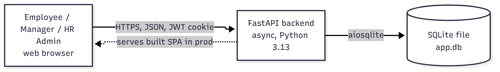

# 1. High-Level Design

## 1.1 Purpose
Leave and shift coverage are managed manually today; several people off on the same day causes coverage
failures, and teams working through the week struggle to balance shifts. This system is **one place to manage
leave and shifts where a coverage gap can't slip through unnoticed**. Every leave request, roster change and
shift swap is checked against each shift's **minimum headcount** before it is accepted.

## 1.2 Users and what they do
| Role | Main jobs in the system |
|---|---|
| **Employee** | See balances, apply for / cancel leave, see own shifts, propose and answer shift swaps, see team calendar. |
| **Manager** (one per team) | Everything an employee does for themselves, plus: build the team roster, configure the team's shifts, approve/reject the team's leave and swaps, watch the dashboard (pending approvals, coverage gaps, who's available today). Their own leave is approved by HR. |
| **HR Admin** | Manage users (create, edit, deactivate), teams and managers, leave types and accrual, shift templates for any team; approve managers' leave; view the full audit log. Doesn't take leave in the system. |

## 1.3 Scope
In: multiple teams in one org and location; multiple leave types with one accrual rule; coverage = minimum
headcount per shift; single-level approval; in-app notifications; IST only.
Out (headline items): payroll/HRIS integration (data is seeded), multi-level approvals, skill-based coverage,
multi-org/location, half-days, public holidays, email and other channels, scheduled reminders, CSV export,
SSO/MFA, CI. The complete list, with the source of each exclusion, is in the
[feature plan](00-feature-plan.md#out-of-scope-explicit).

## 1.4 System overview
A browser single-page app (React + TypeScript) talks JSON over HTTPS to a FastAPI backend, which stores
everything in one SQLite file. In production the backend also serves the built frontend, so it is a single
process on a single port.

<!-- diagram: hld-system-overview -->


<details>
<summary>Diagram source (Mermaid)</summary>

```text
flowchart LR
  U[Employee / Manager / HR Admin<br/>web browser] -- HTTPS, JSON, JWT cookie --> API[FastAPI backend<br/>async, Python 3.13]
  API -- aiosqlite --> DB[(SQLite file<br/>app.db)]
  API -. serves built SPA in prod .-> U
```

</details>

Details: [Architecture](04-architecture.md).

## 1.5 Functional building blocks
The backend is split into platform pieces and twelve domain components (full breakdown in the
[Low-level design](02-low-level-design.md)):

| Component | Responsibility | BRD feature |
|---|---|---|
| C1 Identity & Access | Login/logout, JWT cookie, current user, role checks | — |
| C2 Org Admin | Users (soft delete), teams, team manager | — |
| C3 Leave Type Config | Leave types: entitlement, carry-forward cap, archive | 1 |
| C4 Shift Config | Per-team shift templates and min headcount | 3, 5 |
| C5 Accrual & Balances | Ledger, monthly accrual, year-end carry-forward, adjustments | 1 |
| C6 Leave Requests | Apply, approve/reject, cancel with re-roster + per-day refund | 2 |
| C7 Roster | Assign/unassign, copy week, "my shifts" | 3 |
| C8 Swaps | Propose → accept → approve 1-for-1 exchanges | 4 |
| C9 Coverage Engine | Headcount and gap calculation shared by everyone | 5 |
| C10 Read Models | Unified calendar, manager dashboard | 6, 7 |
| C11 Audit Log | Append-only record of every change | 8 |
| C12 Notifications | In-app alerts for approvals, coverage, roster changes | 9 |

## 1.6 Key flows (summary)
1. **Apply for leave** — employee picks type and dates → system counts Mon–Fri days, checks balance (minus pending),
   overlap, and **coverage of every shift they're rostered on** (counting others' pending leave) → saved as
   *pending* → manager notified.
2. **Approve leave** — manager approves → balance and coverage re-checked → days deducted → employee taken off the
   shifts in that period (recorded) → employee notified.
3. **Cancel approved leave** — before it starts → removed shifts restored where possible → each working day
   refunded, or *owed* until the person is re-rostered that day (forfeited if the day passes).
4. **Build roster** — manager assigns people to shift × date; guards stop assignments to people on leave,
   overlapping shifts and past dates; each cell shows headcount vs minimum.
5. **Swap shifts** — A offers a shift for teammate B's shift → B accepts → manager approves → exchanged. Blocked if
   either is on approved/pending leave on either date or would be double-booked.
6. **Dashboard** — manager sees pending leave and swaps, today's and next 7 days' gaps, and who is on shift / on
   leave / off today, in one view.

## 1.7 Cross-cutting concerns
- **Coverage is enforced in one place.** Every write that can change headcount (leave apply/approve, roster
  edits, swaps, deactivation, archiving a shift) goes through the Coverage Engine.
- **Consistency.** Each API request runs in one database transaction; write requests take SQLite's write lock up
  front (`BEGIN IMMEDIATE`), so two concurrent approvals can't both pass a coverage check that only one should.
- **Balances are a ledger.** No balance column is ever updated; balance = sum of ledger rows. Accrual runs are
  idempotent (unique per user/type/period).
- **Audit.** Every write appends an audit row (actor, action, entity, before/after). The table rejects UPDATE and
  DELETE via database triggers.
- **Security.** bcrypt passwords; JWT in an httpOnly SameSite=Lax cookie; user re-loaded from DB per request (so
  deactivation and role changes apply immediately); role and ownership checked in the service layer, not only the
  UI.
- **Time.** All dates are IST calendar dates; one `clock` module supplies "today", pinnable for tests and demos.

## 1.8 Non-functional targets
| Area | Target |
|---|---|
| Scale | One organisation: up to ~500 users, ~20 teams, a few years of history. |
| Latency | p95 < 300 ms for any API call on a laptop with seeded data. |
| Availability | Single process; no HA requirement (course project). |
| Data safety | SQLite WAL mode; DB file can be copied for backup while stopped. |
| Accessibility | Keyboard-usable forms and tables; status never conveyed by colour alone. |

## 1.9 Risks
| Risk | Mitigation |
|---|---|
| SQLite allows one writer at a time | Short transactions; `BEGIN IMMEDIATE`; busy timeout. Fine at this scale. |
| Stateless JWT can't be revoked | 8 h lifetime; per-request DB check for active user and password reset time. |
| Coverage rules spread across features drift apart | Single Coverage Engine + tests per entry point. |
| Weekend-shift loophole of the Mon–Fri rule | Listed as an open question in the [feature plan](00-feature-plan.md). |
