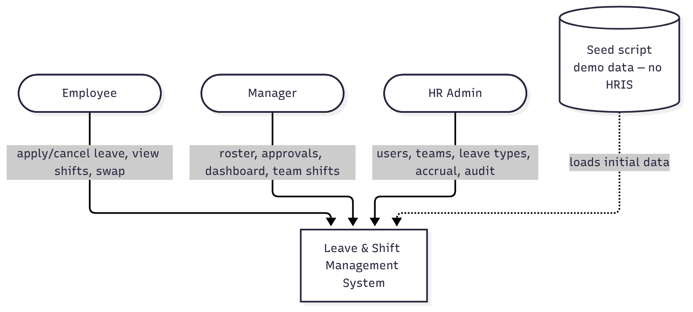
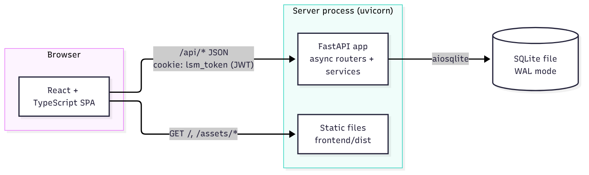
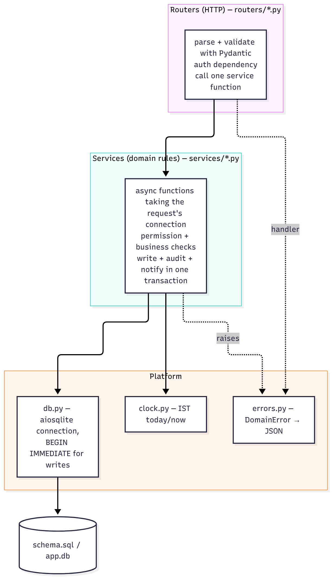
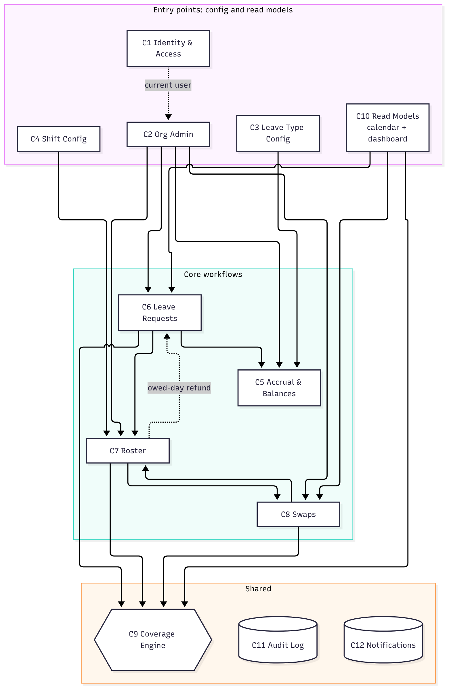
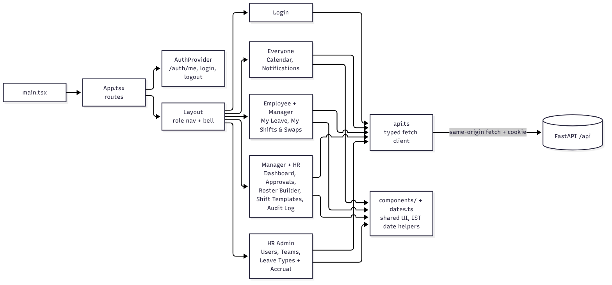
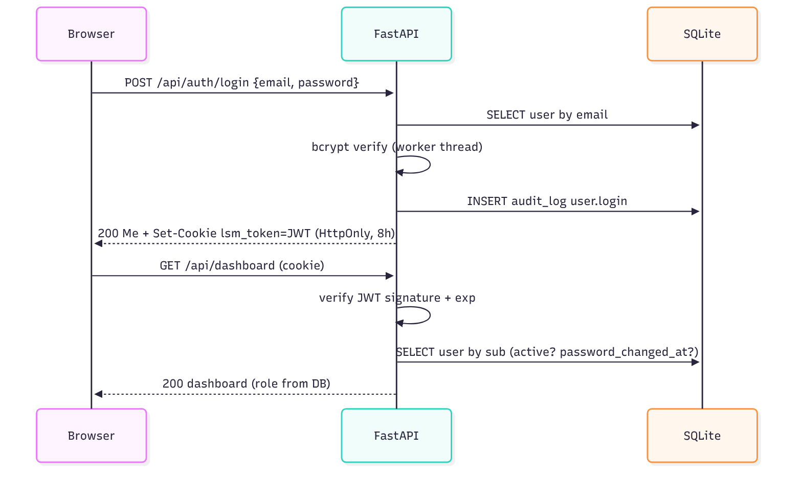
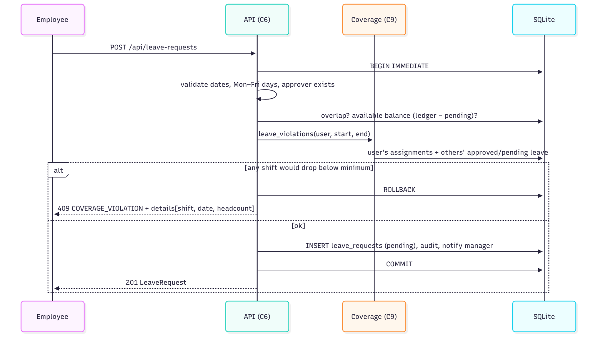
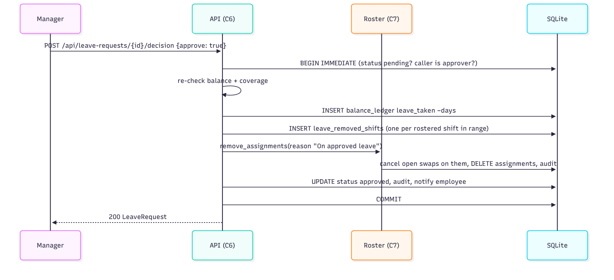
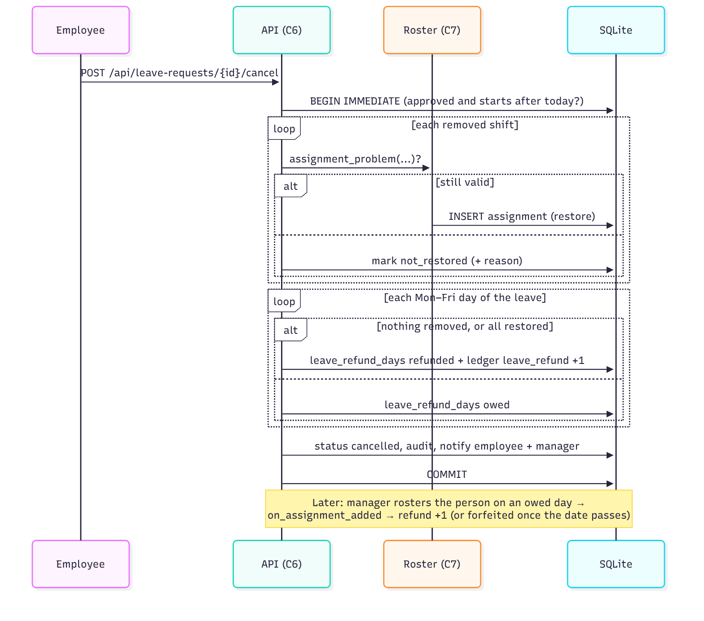
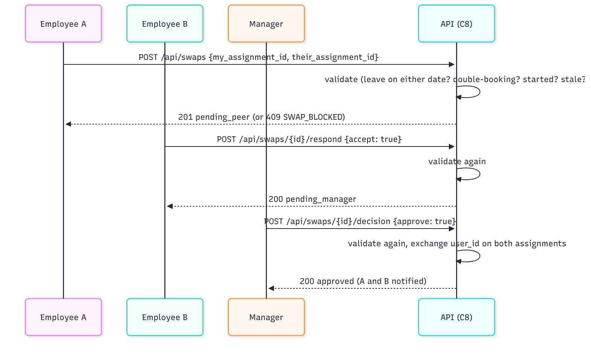

# 4. Architecture

## 4.1 System context

<!-- diagram: arch-context -->


<details>
<summary>Diagram source (Mermaid)</summary>

```text
flowchart TB
  emp([Employee])
  mgr([Manager])
  hr([HR Admin])
  sys[Leave & Shift Management System]
  seed[(Seed script<br/>demo data — no HRIS)]
  emp -- apply/cancel leave, view shifts, swap --> sys
  mgr -- roster, approvals, dashboard, team shifts --> sys
  hr -- users, teams, leave types, accrual, audit --> sys
  seed -. loads initial data .-> sys
```

</details>

No external systems: no payroll/HRIS, no email, no SSO.

## 4.2 Containers & deployment

<!-- diagram: arch-containers -->


<details>
<summary>Diagram source (Mermaid)</summary>

```text
flowchart LR
  subgraph Browser
    SPA[React + TypeScript SPA]
  end
  subgraph "Server process (uvicorn)"
    API[FastAPI app<br/>async routers + services]
    STATIC[Static files<br/>frontend/dist]
  end
  DB[(SQLite file<br/>WAL mode)]
  SPA -- "/api/* JSON<br/>cookie: lsm_token (JWT)" --> API
  SPA -- "GET /, /assets/*" --> STATIC
  API -- aiosqlite --> DB
```

</details>

| Mode | Processes | Notes |
|---|---|---|
| **Dev** | Vite dev server :5173 (HMR) + uvicorn :8000 `--reload` | Vite proxies `/api` → :8000, so the cookie is same-origin; no CORS needed. |
| **Prod / demo** | uvicorn :8000 only | `npm run build` → `app/frontend/dist`; FastAPI serves it and falls back to `index.html` for client routes (anything not under `/api`). |

## 4.3 Backend layers

<!-- diagram: arch-backend-layers -->


<details>
<summary>Diagram source (Mermaid)</summary>

```text
flowchart TB
  subgraph Routers["Routers (HTTP) — routers/*.py"]
    R[parse + validate with Pydantic<br/>auth dependency<br/>call one service function]
  end
  subgraph Services["Services (domain rules) — services/*.py"]
    S[async functions taking the request's connection<br/>permission + business checks<br/>write + audit + notify in one transaction]
  end
  subgraph Platform
    DBL[db.py — aiosqlite connection,<br/>BEGIN IMMEDIATE for writes]
    CLK[clock.py — IST today/now]
    ERR[errors.py — DomainError → JSON]
  end
  SQL[(schema.sql / app.db)]
  R --> S --> DBL --> SQL
  S --> CLK
  S -. raises .-> ERR
  R -. handler .-> ERR
```

</details>

Rules: routers contain no SQL and no business rules; services never import FastAPI request objects; every write
path appends to the audit log in the same transaction.

## 4.4 Backend components

<!-- diagram: arch-components -->


<details>
<summary>Diagram source (Mermaid)</summary>

```text
flowchart TB
  subgraph Entry["Entry points: config and read models"]
    C1[C1 Identity & Access]
    C2[C2 Org Admin]
    C3[C3 Leave Type Config]
    C4[C4 Shift Config]
    C10[C10 Read Models<br/>calendar + dashboard]
  end
  subgraph Core["Core workflows"]
    C6[C6 Leave Requests]
    C7[C7 Roster]
    C8[C8 Swaps]
    C5[C5 Accrual & Balances]
  end
  subgraph Shared["Shared"]
    C9{{C9 Coverage Engine}}
    C11[(C11 Audit Log)]
    C12[(C12 Notifications)]
  end

  C1 -. current user .-> C2
  C2 --> C5 & C6 & C7 & C8
  C3 --> C5
  C4 --> C7
  C10 --> C6 & C8 & C9
  C6 --> C5 & C7 & C9
  C7 --> C8 & C9
  C7 -. owed-day refund .-> C6
  C8 --> C7 & C9
```

</details>

C9 is the only place headcount and gaps are computed. C11 (C2–C8 write to it) and C12 (C2, C6, C7, C8 write to
it) are write-only sinks, drawn without arrows to keep the graph readable. C1 reads users owned by C2 to resolve
the current user and role on every request.

## 4.5 Frontend structure

<!-- diagram: arch-frontend -->


<details>
<summary>Diagram source (Mermaid)</summary>

```text
flowchart LR
  main[main.tsx] --> App[App.tsx<br/>routes]
  App --> Auth[AuthProvider<br/>/auth/me, login, logout]
  App --> Layout[Layout<br/>role nav + bell]
  Layout --> Login[Login]
  Layout --> Emp[Everyone<br/>Calendar, Notifications]
  Layout --> EM[Employee + Manager<br/>My Leave, My Shifts & Swaps]
  Layout --> Mgr[Manager + HR<br/>Dashboard, Approvals,<br/>Roster Builder, Shift Templates, Audit Log]
  Layout --> HR[HR Admin<br/>Users, Teams,<br/>Leave Types + Accrual]
  Login & Emp & EM & Mgr & HR --> API[api.ts<br/>typed fetch client]
  Emp & EM & Mgr & HR --> UI[components/ + dates.ts<br/>shared UI, IST date helpers]
  API -- same-origin fetch + cookie --> Backend[(FastAPI /api)]
```

</details>

## 4.6 Key sequences

### Login and an authenticated request
<!-- diagram: seq-login -->


<details>
<summary>Diagram source (Mermaid)</summary>

```text
sequenceDiagram
  participant B as Browser
  participant A as FastAPI
  participant D as SQLite
  B->>A: POST /api/auth/login {email, password}
  A->>D: SELECT user by email
  A->>A: bcrypt verify (worker thread)
  A->>D: INSERT audit_log user.login
  A-->>B: 200 Me + Set-Cookie lsm_token=JWT (HttpOnly, 8h)
  B->>A: GET /api/dashboard (cookie)
  A->>A: verify JWT signature + exp
  A->>D: SELECT user by sub (active? password_changed_at?)
  A-->>B: 200 dashboard (role from DB)
```

</details>

### Apply for leave (coverage hard block)
<!-- diagram: seq-apply-leave -->


<details>
<summary>Diagram source (Mermaid)</summary>

```text
sequenceDiagram
  participant E as Employee
  participant A as API (C6)
  participant C as Coverage (C9)
  participant D as SQLite
  E->>A: POST /api/leave-requests
  A->>D: BEGIN IMMEDIATE
  A->>A: validate dates, Mon–Fri days, approver exists
  A->>D: overlap? available balance (ledger − pending)?
  A->>C: leave_violations(user, start, end)
  C->>D: user's assignments + others' approved/pending leave
  alt any shift would drop below minimum
    A->>D: ROLLBACK
    A-->>E: 409 COVERAGE_VIOLATION + details[shift, date, headcount]
  else ok
    A->>D: INSERT leave_requests (pending), audit, notify manager
    A->>D: COMMIT
    A-->>E: 201 LeaveRequest
  end
```

</details>

### Approve leave
<!-- diagram: seq-approve-leave -->


<details>
<summary>Diagram source (Mermaid)</summary>

```text
sequenceDiagram
  participant M as Manager
  participant A as API (C6)
  participant R as Roster (C7)
  participant D as SQLite
  M->>A: POST /api/leave-requests/{id}/decision {approve: true}
  A->>D: BEGIN IMMEDIATE (status pending? caller is approver?)
  A->>A: re-check balance + coverage
  A->>D: INSERT balance_ledger leave_taken −days
  A->>D: INSERT leave_removed_shifts (one per rostered shift in range)
  A->>R: remove_assignments(reason "On approved leave")
  R->>D: cancel open swaps on them, DELETE assignments, audit
  A->>D: UPDATE status approved, audit, notify employee
  A->>D: COMMIT
  A-->>M: 200 LeaveRequest
```

</details>

### Cancel approved leave (re-roster + per-day refund)
<!-- diagram: seq-cancel-approved-leave -->


<details>
<summary>Diagram source (Mermaid)</summary>

```text
sequenceDiagram
  participant E as Employee
  participant A as API (C6)
  participant R as Roster (C7)
  participant D as SQLite
  E->>A: POST /api/leave-requests/{id}/cancel
  A->>D: BEGIN IMMEDIATE (approved and starts after today?)
  loop each removed shift
    A->>R: assignment_problem(...)?
    alt still valid
      R->>D: INSERT assignment (restore)
    else
      A->>D: mark not_restored (+ reason)
    end
  end
  loop each Mon–Fri day of the leave
    alt nothing removed, or all restored
      A->>D: leave_refund_days refunded + ledger leave_refund +1
    else
      A->>D: leave_refund_days owed
    end
  end
  A->>D: status cancelled, audit, notify employee + manager
  A->>D: COMMIT
  Note over A,D: Later: manager rosters the person on an owed day →<br/>on_assignment_added → refund +1 (or forfeited once the date passes)
```

</details>

### Shift swap
<!-- diagram: seq-swap -->


<details>
<summary>Diagram source (Mermaid)</summary>

```text
sequenceDiagram
  participant A as Employee A
  participant B as Employee B
  participant M as Manager
  participant S as API (C8)
  A->>S: POST /api/swaps {my_assignment_id, their_assignment_id}
  S->>S: validate (leave on either date? double-booking? started? stale?)
  S-->>A: 201 pending_peer (or 409 SWAP_BLOCKED)
  B->>S: POST /api/swaps/{id}/respond {accept: true}
  S->>S: validate again
  S-->>B: 200 pending_manager
  M->>S: POST /api/swaps/{id}/decision {approve: true}
  S->>S: validate again, exchange user_id on both assignments
  S-->>M: 200 approved (A and B notified)
```

</details>

## 4.7 Startup (lifespan)
1. Open DB, run `schema.sql`, WAL mode, schema version.
2. `expire_owed_days()` (owed refund days in the past → forfeited).
3. `accrual.catch_up()` (last year's close if missing, this year's months to date).
4. Mount static frontend if `frontend/dist` exists.

## 4.8 Security boundaries
| Boundary | Control |
|---|---|
| Browser ↔ API | JWT in HttpOnly SameSite=Lax cookie; JSON-only bodies; `Secure` cookie behind HTTPS |
| Request → service | User reloaded from DB per request; role + ownership checks in services |
| Service → DB | Parameterised SQL only; foreign keys on; one transaction per request |
| Audit | Append-only via triggers; no API to modify it |
| Secrets | `LSM_JWT_SECRET` from environment; never committed |
