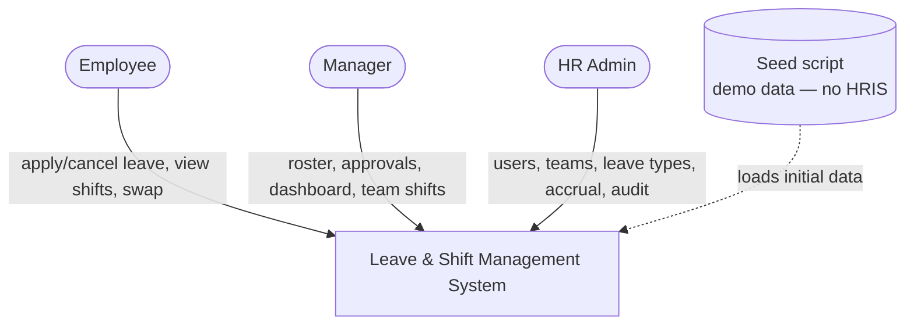
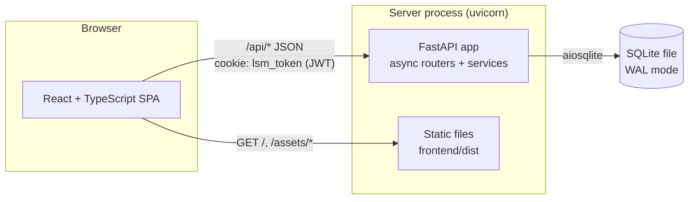
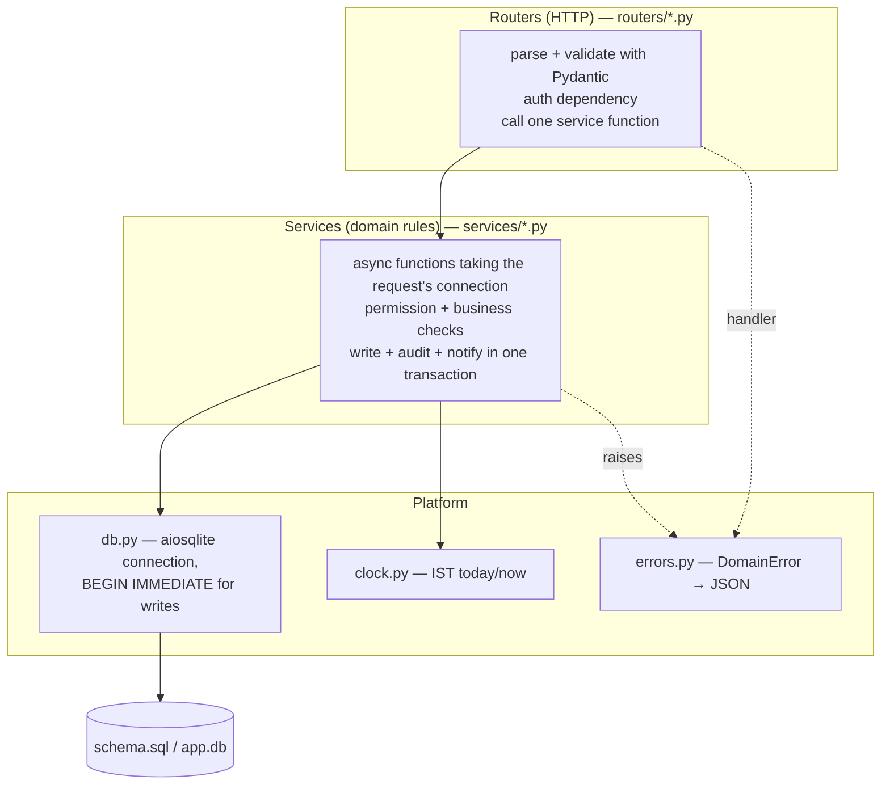
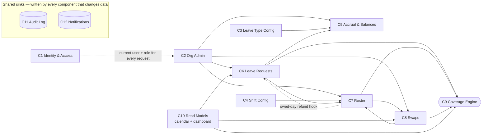
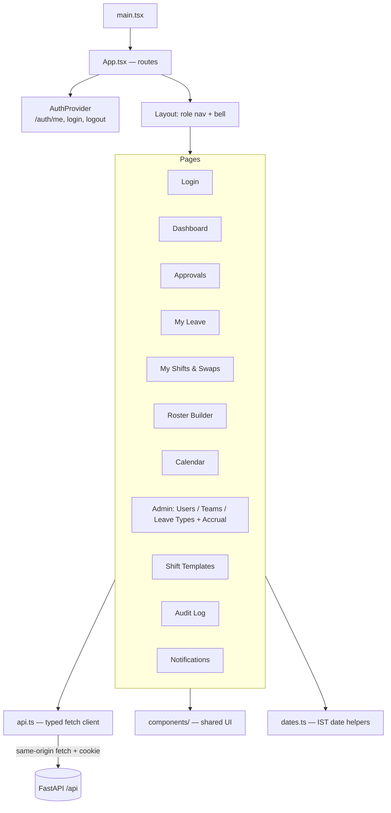
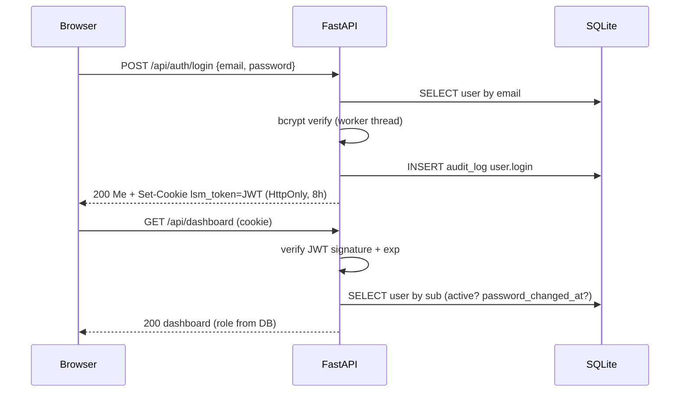
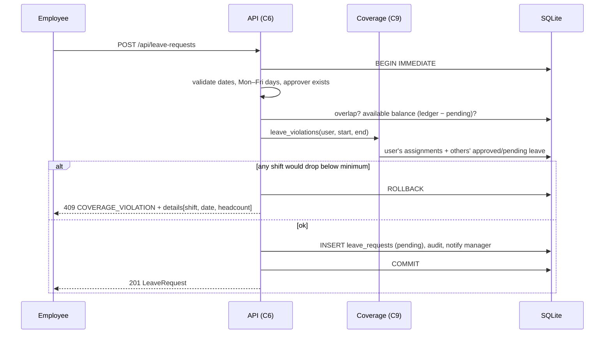
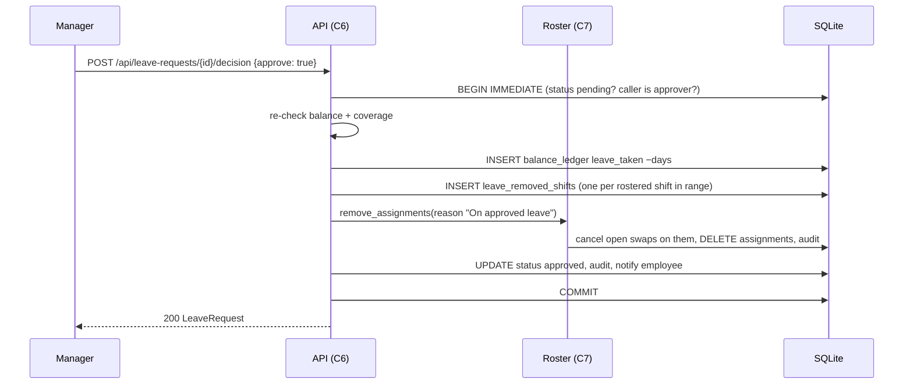
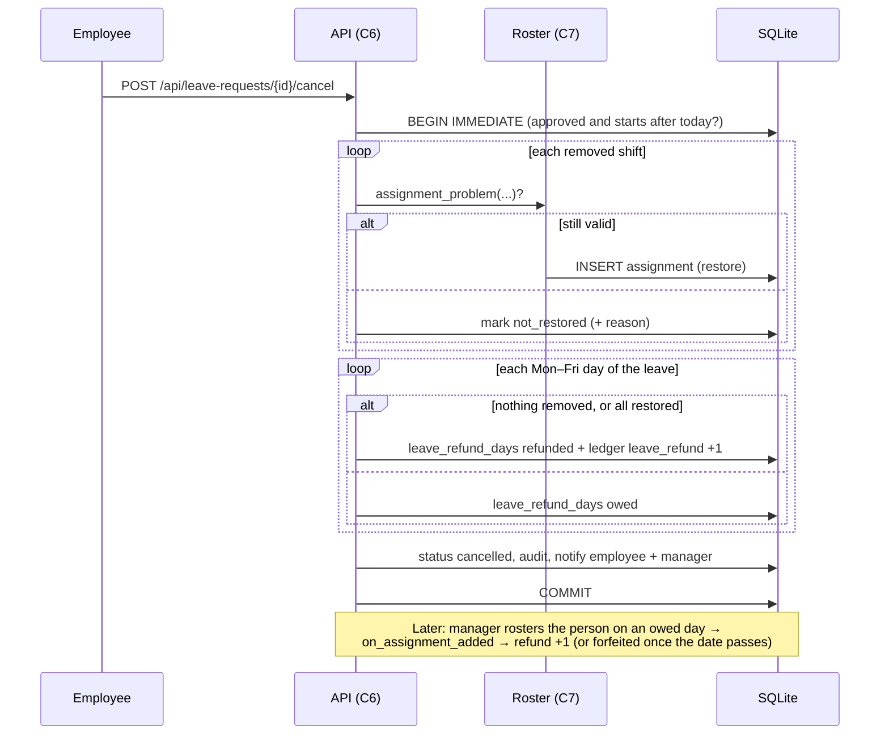
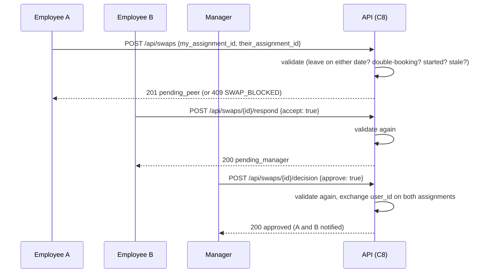

# 4. Architecture

## 4.1 System context

No external systems: no payroll/HRIS, no email, no SSO.

## 4.2 Containers & deployment

| Mode | Processes | Notes |
|---|---|---|
| **Dev** | Vite dev server :5173 (HMR) + uvicorn :8000 `--reload` | Vite proxies `/api` → :8000, so the cookie is same-origin; no CORS needed. |
| **Prod / demo** | uvicorn :8000 only | `npm run build` → `app/frontend/dist`; FastAPI serves it and falls back to `index.html` for client routes (anything not under `/api`). |

## 4.3 Backend layers

Rules: routers contain no SQL and no business rules; services never import FastAPI request objects; every write
path appends to the audit log in the same transaction.

## 4.4 Backend components

C9 is the only place headcount and gaps are computed. C11 (C2–C8 write to it) and C12 (C2, C6, C7, C8 write to
it) are write-only sinks, drawn without arrows to keep the graph readable.

## 4.5 Frontend structure

## 4.6 Key sequences

### Login and an authenticated request

### Apply for leave (coverage hard block)

### Approve leave

### Cancel approved leave (re-roster + per-day refund)

### Shift swap

## 4.7 Startup (lifespan)
1. Open DB, run `schema.sql`, WAL mode, schema version.
2. `expire_owed_days()` (owed refund days in the past → forfeited).
3. `accrual.catch_up()` (last year's close if missing, this year's months to date).
4. Mount static frontend if `frontend/dist` exists.

## 4.8 Security boundaries
| Boundary | Control |
|---|---|
| Browser ↔ API | JWT in HttpOnly SameSite=Lax cookie; JSON-only bodies; `Secure` cookie behind HTTPS |
| Request → service | User reloaded from DB per request; role + ownership checks in services |
| Service → DB | Parameterised SQL only; foreign keys on; one transaction per request |
| Audit | Append-only via triggers; no API to modify it |
| Secrets | `LSM_JWT_SECRET` from environment; never committed |
