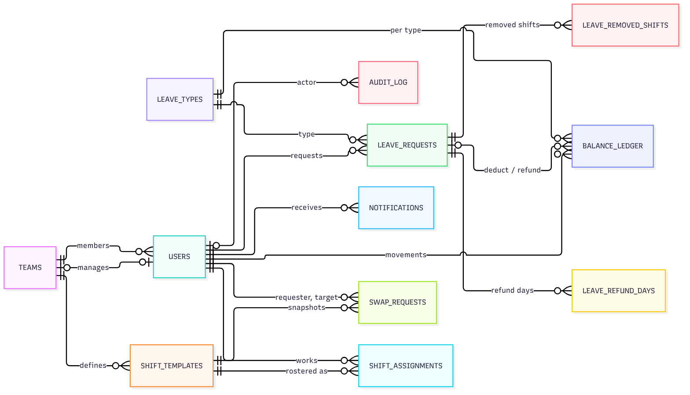
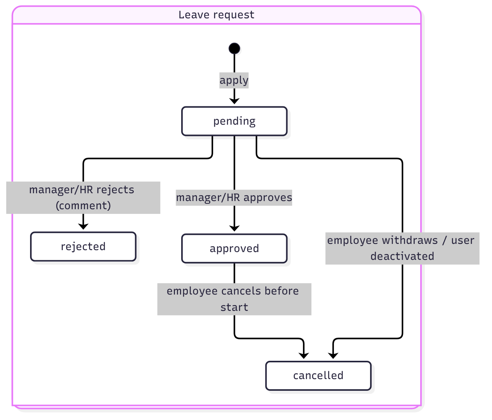
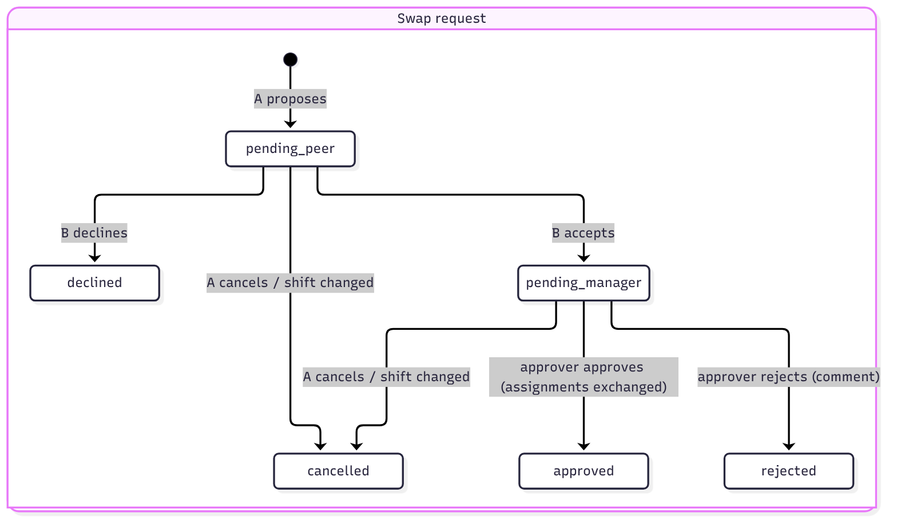
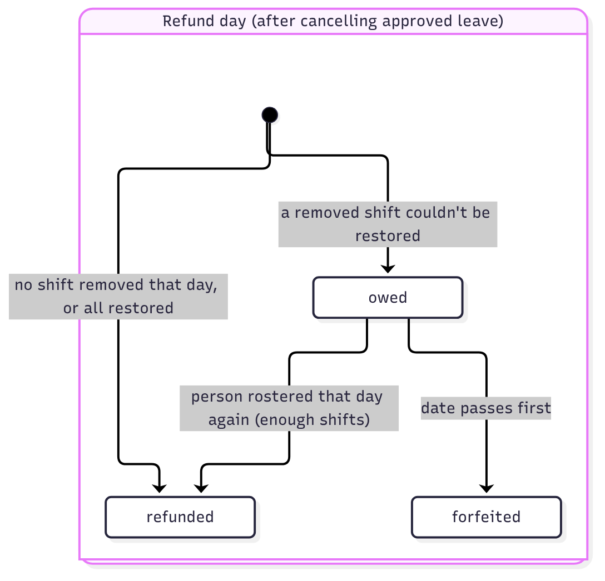

# 5. Data Model

SQLite, one file. Conventions:
- `id INTEGER PRIMARY KEY` on every table; foreign keys enforced (`PRAGMA foreign_keys = ON`).
- Dates: `TEXT 'YYYY-MM-DD'` (IST calendar date). Times: `TEXT 'HH:MM'`. Timestamps: `TEXT` ISO-8601 with `+05:30`.
- Booleans: `INTEGER` 0/1. Leave quantities: `REAL`, rounded to 2 decimals in code.
- Nothing is hard-deleted except `shift_assignments` rows (an unassignment) — and every such delete is audited.
- Implemented in [`app/backend/app/schema.sql`](../app/backend/app/schema.sql); see [5.6](#56-schema-file) for
  what the file enforces beyond this page.

## 5.1 Entity-relationship diagram

<!-- diagram: data-er -->


<details>
<summary>Diagram source (Mermaid)</summary>

```text
erDiagram
  direction LR
  TEAMS ||--o{ USERS : "members"
  USERS |o--o| TEAMS : "manages"
  TEAMS ||--o{ SHIFT_TEMPLATES : "defines"
  SHIFT_TEMPLATES ||--o{ SHIFT_ASSIGNMENTS : "rostered as"
  USERS ||--o{ SHIFT_ASSIGNMENTS : "works"
  USERS ||--o{ LEAVE_REQUESTS : "requests"
  LEAVE_TYPES ||--o{ LEAVE_REQUESTS : "type"
  LEAVE_REQUESTS ||--o{ LEAVE_REMOVED_SHIFTS : "removed shifts"
  LEAVE_REQUESTS ||--o{ LEAVE_REFUND_DAYS : "refund days"
  USERS ||--o{ BALANCE_LEDGER : "movements"
  LEAVE_TYPES ||--o{ BALANCE_LEDGER : "per type"
  LEAVE_REQUESTS |o--o{ BALANCE_LEDGER : "deduct / refund"
  USERS ||--o{ SWAP_REQUESTS : "requester, target"
  SHIFT_TEMPLATES ||--o{ SWAP_REQUESTS : "snapshots"
  USERS ||--o{ NOTIFICATIONS : "receives"
  USERS |o--o{ AUDIT_LOG : "actor"
```

</details>

`teams.manager_id` holds the "manages" link; a NULL audit actor means System.

## 5.2 Tables

### `schema_meta`
| Column | Type | Notes |
|---|---|---|
| key | TEXT PK | e.g. `schema_version` |
| value | TEXT | |

### `teams`
| Column | Type | Constraints / notes |
|---|---|---|
| id | INTEGER PK | |
| name | TEXT | NOT NULL, UNIQUE (case-insensitive) |
| department | TEXT | NOT NULL DEFAULT '' — a label only |
| manager_id | INTEGER | FK → users.id, NULL = no manager (team blocked from new leave/swaps) |
| created_at | TEXT | NOT NULL |

Invariant (service-enforced): `manager_id` points to an **active** user with role `manager` whose `team_id` is
this team; a user manages at most one team.

### `users`
| Column | Type | Constraints / notes |
|---|---|---|
| id | INTEGER PK | |
| name | TEXT | NOT NULL |
| email | TEXT | NOT NULL, UNIQUE (case-insensitive), stored lower-case |
| password_hash | TEXT | NOT NULL, bcrypt |
| role | TEXT | NOT NULL, CHECK IN (`employee`, `manager`, `hr_admin`) |
| team_id | INTEGER | FK → teams.id; CHECK: NULL iff role = `hr_admin` |
| join_date | TEXT | NOT NULL; accrual starts in this month |
| active | INTEGER | NOT NULL DEFAULT 1; 0 = deactivated (soft delete) |
| password_changed_at | TEXT | NOT NULL; JWTs issued before this are rejected |
| created_at | TEXT | NOT NULL |
| deactivated_at | TEXT | NULL |

### `leave_types`
| Column | Type | Constraints / notes |
|---|---|---|
| id | INTEGER PK | |
| name | TEXT | NOT NULL, UNIQUE (case-insensitive) |
| annual_entitlement | REAL | NOT NULL, 0–366 |
| carry_forward_cap | REAL | NOT NULL, ≥ 0 |
| active | INTEGER | NOT NULL DEFAULT 1; 0 = archived |

### `shift_templates`
| Column | Type | Constraints / notes |
|---|---|---|
| id | INTEGER PK | |
| team_id | INTEGER | NOT NULL FK → teams.id; never changes |
| name | TEXT | NOT NULL; UNIQUE (team_id, name) |
| start_time | TEXT | NOT NULL `HH:MM` |
| end_time | TEXT | NOT NULL `HH:MM`, ≠ start_time; `end ≤ start` means it ends next day |
| days_of_week | TEXT | NOT NULL, e.g. `0,1,2,3,4` (0 = Monday … 6 = Sunday) |
| min_headcount | INTEGER | NOT NULL, ≥ 0 |
| active | INTEGER | NOT NULL DEFAULT 1; 0 = archived |

### `shift_assignments` — the roster
| Column | Type | Constraints / notes |
|---|---|---|
| id | INTEGER PK | |
| user_id | INTEGER | NOT NULL FK → users.id |
| shift_template_id | INTEGER | NOT NULL FK → shift_templates.id |
| date | TEXT | NOT NULL — the date the shift **starts** |
| created_by | INTEGER | FK → users.id (NULL = system, e.g. restore on cancel) |
| created_at | TEXT | NOT NULL |

UNIQUE (user_id, shift_template_id, date). Indexes: (shift_template_id, date), (user_id, date).
A swap changes `user_id` on two rows in place.

### `leave_requests`
| Column | Type | Constraints / notes |
|---|---|---|
| id | INTEGER PK | |
| user_id | INTEGER | NOT NULL FK → users.id |
| leave_type_id | INTEGER | NOT NULL FK → leave_types.id |
| start_date / end_date | TEXT | NOT NULL; CHECK end ≥ start and same calendar year |
| days | REAL | NOT NULL — Mon–Fri days in range, fixed at submission |
| reason | TEXT | NOT NULL DEFAULT '' |
| status | TEXT | CHECK IN (`pending`, `approved`, `rejected`, `cancelled`) |
| decided_by | INTEGER | FK → users.id |
| decided_at | TEXT | |
| decision_comment | TEXT | required when rejected |
| cancelled_at | TEXT | |
| created_at | TEXT | NOT NULL |

Index: (user_id, status), (start_date, end_date).

### `leave_removed_shifts` — shifts taken away when leave was approved
| Column | Type | Constraints / notes |
|---|---|---|
| id | INTEGER PK | |
| leave_request_id | INTEGER | NOT NULL FK → leave_requests.id |
| user_id | INTEGER | NOT NULL FK → users.id |
| shift_template_id | INTEGER | NOT NULL FK → shift_templates.id |
| date | TEXT | NOT NULL |
| status | TEXT | CHECK IN (`removed`, `restored`, `not_restored`) — set on cancel |
| restored_assignment_id | INTEGER | the new assignment row if restored |
| note | TEXT | why not restored (e.g. "shift archived") |

### `leave_refund_days` — per-day refund state after cancelling approved leave
| Column | Type | Constraints / notes |
|---|---|---|
| id | INTEGER PK | |
| leave_request_id | INTEGER | NOT NULL FK → leave_requests.id |
| user_id | INTEGER | NOT NULL FK → users.id |
| leave_type_id | INTEGER | NOT NULL FK → leave_types.id |
| date | TEXT | NOT NULL — a Mon–Fri date of the cancelled leave; UNIQUE (leave_request_id, date) |
| shifts_removed | INTEGER | NOT NULL — removed shifts that day (refund needs that many assignments again) |
| status | TEXT | CHECK IN (`refunded`, `owed`, `forfeited`) |
| ledger_entry_id | INTEGER | FK → balance_ledger.id when refunded |
| resolved_at | TEXT | when it became refunded/forfeited |

Index: (user_id, date, status) — looked up on every roster assignment.

### `balance_ledger` — every balance movement
| Column | Type | Constraints / notes |
|---|---|---|
| id | INTEGER PK | |
| user_id | INTEGER | NOT NULL FK → users.id |
| leave_type_id | INTEGER | NOT NULL FK → leave_types.id |
| year | INTEGER | NOT NULL — balance year the movement belongs to |
| kind | TEXT | CHECK IN (`accrual`, `carry_forward`, `year_end_close`, `leave_taken`, `leave_refund`, `adjustment`) |
| amount | REAL | NOT NULL; + credit, − debit |
| period | TEXT | `YYYY-MM` for accrual; `YYYY` (closing year) for year-end rows |
| leave_request_id | INTEGER | FK → leave_requests.id for `leave_taken` / `leave_refund` |
| reason | TEXT | NOT NULL DEFAULT '' (required for `adjustment`) |
| created_by | INTEGER | FK → users.id; NULL = system |
| created_at | TEXT | NOT NULL |

Partial UNIQUE (user_id, leave_type_id, kind, period) WHERE kind IN (`accrual`, `carry_forward`,
`year_end_close`) → accrual and year-end runs are idempotent.

### `swap_requests`
| Column | Type | Constraints / notes |
|---|---|---|
| id | INTEGER PK | |
| requester_id / target_id | INTEGER | NOT NULL FK → users.id |
| team_id | INTEGER | NOT NULL FK → teams.id |
| requester_assignment_id / target_assignment_id | INTEGER | NOT NULL — the two roster rows |
| requester_shift_id, requester_date | INTEGER, TEXT | snapshot of the offered shift |
| target_shift_id, target_date | INTEGER, TEXT | snapshot of the requested shift |
| status | TEXT | CHECK IN (`pending_peer`, `pending_manager`, `approved`, `rejected`, `declined`, `cancelled`) |
| peer_responded_at | TEXT | |
| decided_by, decided_at, decision_comment | | manager/HR decision |
| created_at | TEXT | NOT NULL |

Snapshots let every later step check that both shifts are unchanged since the proposal.

### `notifications`
| Column | Type | Notes |
|---|---|---|
| id | INTEGER PK | |
| user_id | INTEGER | NOT NULL FK → users.id |
| kind | TEXT | `approval`, `leave`, `swap`, `roster`, `coverage` |
| message | TEXT | NOT NULL |
| link | TEXT | in-app route, e.g. `/approvals` |
| read | INTEGER | NOT NULL DEFAULT 0 |
| created_at | TEXT | NOT NULL |

Index: (user_id, read).

### `audit_log` — append-only
| Column | Type | Notes |
|---|---|---|
| id | INTEGER PK | |
| actor_id | INTEGER | FK → users.id; NULL = System |
| actor_name | TEXT | NOT NULL — copied so the log reads correctly forever |
| action | TEXT | e.g. `leave.approve`, `roster.assign`, `user.deactivate` |
| entity_type | TEXT | e.g. `leave_request`, `shift_assignment`, `user` |
| entity_id | INTEGER | |
| team_id | INTEGER | lets managers see their team's entries |
| before_json / after_json | TEXT | JSON snapshots; never contain password hashes |
| created_at | TEXT | NOT NULL |

Triggers `BEFORE UPDATE` and `BEFORE DELETE` on `audit_log` → `RAISE(ABORT, 'audit_log is append-only')`.

## 5.3 Derived values (never stored)
For user *u*, leave type *t*, year *y*:
- **balance** = `SUM(amount)` of ledger rows (u, t, y)
- **pending** = `SUM(days)` of `pending` leave requests (u, t) starting in *y*
- **available** = balance − pending (what a new request may use)
- **accrued / carried forward / adjustments** = `SUM(amount)` per kind
- **used** = −(`leave_taken` + `leave_refund`)
- **headcount**(shift, date) = assignments for that shift and date whose user is active and **not** on approved or
  pending leave that date; **gap** = headcount < min_headcount

Monthly credit for month *m* = round(E·m/12, 2) − round(E·(m−1)/12, 2), so twelve credits sum exactly to E.

## 5.4 State machines

<!-- diagram: state-leave-request -->


<details>
<summary>Diagram source (Mermaid)</summary>

```text
stateDiagram-v2
  direction LR
  state "Leave request" as L {
    [*] --> pending: apply
    pending --> approved: manager/HR approves
    pending --> rejected: manager/HR rejects (comment)
    pending --> cancelled: employee withdraws / user deactivated
    approved --> cancelled: employee cancels before start
  }
```

</details>

<!-- diagram: state-swap-request -->


<details>
<summary>Diagram source (Mermaid)</summary>

```text
stateDiagram-v2
  direction LR
  state "Swap request" as S {
    [*] --> pending_peer: A proposes
    pending_peer --> pending_manager: B accepts
    pending_peer --> declined: B declines
    pending_peer --> cancelled: A cancels / shift changed
    pending_manager --> approved: approver approves (assignments exchanged)
    pending_manager --> rejected: approver rejects (comment)
    pending_manager --> cancelled: A cancels / shift changed
  }
```

</details>

<!-- diagram: state-refund-day -->


<details>
<summary>Diagram source (Mermaid)</summary>

```text
stateDiagram-v2
  direction LR
  state "Refund day (after cancelling approved leave)" as R {
    [*] --> refunded: no shift removed that day, or all restored
    [*] --> owed: a removed shift couldn't be restored
    owed --> refunded: person rostered that day again (enough shifts)
    owed --> forfeited: date passes first
  }
```

</details>

## 5.5 Seed data (demo)
1 HR Admin; 3 teams (Customer Support: Morning/Evening/Night 7 days; Network Operations: Day Mon–Fri + Weekend;
Billing: General Mon–Fri) each with a manager and 3–8 employees; leave types Annual (18, cap 5), Sick (12, cap 0),
Casual (6, cap 0); last year's accrual, some leave taken and the year-end close; this year's accrual to date; four
weeks of roster; one approved and two pending upcoming leaves; one deliberate coverage gap today.
All seeded users share the password `password123`. The seed is deterministic (same ids every run) and sets a
fixed past `password_changed_at`, so the E2E reset endpoint can reload it without invalidating test logins.

## 5.6 Schema file
[`app/backend/app/schema.sql`](../app/backend/app/schema.sql) creates everything above. It is idempotent
(`IF NOT EXISTS`), so it runs at every startup and again during the E2E reset. On top of the tables in 5.2 it:
- uses **STRICT** tables, so a value of the wrong type is rejected instead of stored;
- checks single-row rules with `CHECK`: valid dates and `HH:MM` times, the `days_of_week` format, lower-case email,
  team NULL iff HR Admin, `deactivated_at` iff inactive, comment required on reject, decider required on
  approve/reject, `cancelled_at` iff cancelled, the sign and `period` shape of each ledger kind, `leave_request_id`
  only on leave movements, refund-day states (`refunded` ⇔ ledger row, `owed` ⇔ unresolved, never on a weekend);
- adds unique rules: one `leave_taken` row per request; one removed-shift row per (request, shift, date); an
  assignment in at most one **open** swap per side; `teams.manager_id` unique (a user manages at most one team);
- leaves `swap_requests.*_assignment_id` **without** a foreign key (closed swaps may point at assignments that
  were later unassigned; the snapshot columns keep the facts), and sets `leave_removed_shifts.restored_assignment_id`
  to NULL if that assignment is later removed.

Rules that need other rows (e.g. "the manager is an active manager of this team", no overlapping shifts) stay in the
services.
