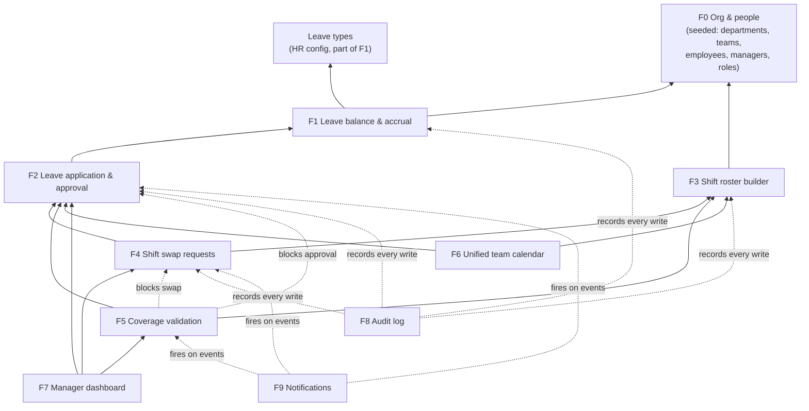

# Feature dependency map & build order

The BRD's nine features (F1–F9), plus the foundation they all sit on (F0), and the order that dependencies force. Terms follow [glossary.md](glossary.md). The topic each step is built at comes from `content/build-plan.md`.

## The map

An arrow means "needs". `A --> B` reads "A needs B to exist first". Dotted arrows are **hooks**: the feature on the left changes how the one on the right behaves, so its seam must be designed before the right-hand feature is built, even though it's implemented later.

## Per feature

| Feature | Needs (hard) | Hooks into | Kind | Built at |
|---|---|---|---|---|
| **F0** Org & people | — | — | Foundation (seeded, not in the BRD's feature list) | T12 |
| Leave types | — | — | HR config | T11 |
| **F1** Leave balance & accrual | F0, leave types | — | Core data | T27 |
| **F2** Leave application & approval | F1 (balance check and deduction), F0 (who the manager is) | — | Core workflow | T27 |
| **F3** Shift roster builder | F0 | — | Core data | T30 |
| **F4** Shift swap requests | F3 (shifts to swap), F2 (approved leave to block, success criterion 2) | — | Core workflow | T31 |
| **F5** Coverage validation | F3 (assignments), F2 (approved leave), minimum-headcount config | **Changes F2 approval and F4 approval** | Cross-cutting rule | T33 (designed at T15 → T26) |
| **F6** Unified team calendar | F2, F3 | — | Read-only view | T35 |
| **F7** Manager dashboard | F2 and F4 (pending items), F5 (gaps), F3 (availability) | — | Read-only view | T34 |
| **F8** Audit log | Nothing to read from, but every write path | **Every write in F1–F5 and HR config** | Cross-cutting record | T42 |
| **F9** Notifications | F2, F4, F5 events | Every state change that alerts someone | Cross-cutting side effect | T43 |

## Build order

Topologically sorted, then ordered by the course:

1. **Leave types** (T11) → **F0** (T12). These two are independent, and T11 runs first because it's the smaller task.
2. **F1 + F2** (T27). Built together, because the balance only matters through requests.
3. **F3** (T30) → **F4** (T31).
4. **F5** (T33). This is the earliest point where everything it reads exists.
5. **F7** (T34) and **F6** (T35). These read-only views can go in either order once F5 exists.
6. **F8** (T42) → **F9** (T43).

## What the map warns about

1. **F5 is designed long before it's built.** It changes how F2 approval (built at T27) and F4 approval (built at T31) behave. If the coverage decision isn't made first (ADR-001 at T26), F2 and F4 get built without a seam, and F5 has to be bolted on afterwards. That bolt-on is how the cold-open app ended up with "approve and cancel the clashing shifts".
2. **F8 is the most expensive feature to build late.** It touches every write path in every feature. The plan builds it at T42 because it pairs with guardrails. The mitigation: from T14 on, the `add-endpoint` skill makes every write call an `audit()` helper, even if that helper is a no-op at first. T42 then makes the log real and immutable, and adds the guardrail that fails any write path that skips it. Without that, T42 means editing every endpoint built on Days 2–4.
3. **F9 has the same shape as F8, but cheaper.** If state changes go through one place (the same seam as above), notifications are a subscriber to those events rather than edits scattered across features.
4. **Success criterion 2 is F4's job, not F5's.** "A swap involving someone on approved leave is blocked" only needs F2 data, so F4 can meet it at T31 before headcount rules exist at T33. Don't let F4 wait on F5.
5. **F6 and F7 are pure readers.** They can be built from a locked API contract by a parallel frontend track (T23c), and they're the safest candidates to pre-build if Day 4 runs long.

## Decision owners (T5)

Filled in during class at Topic 5. Each open question in [glossary.md](glossary.md#open-questions) gets a human owner before the feature it blocks is specified.

| Open question | Owner | Answer by |
|---|---|---|
| Q1–Q16 | *to assign at T5* | |
